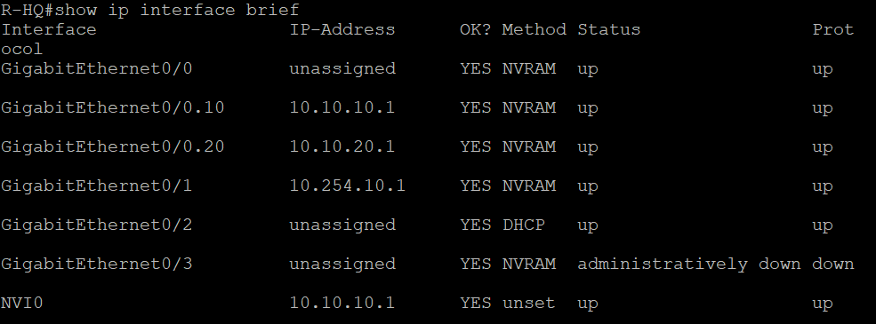
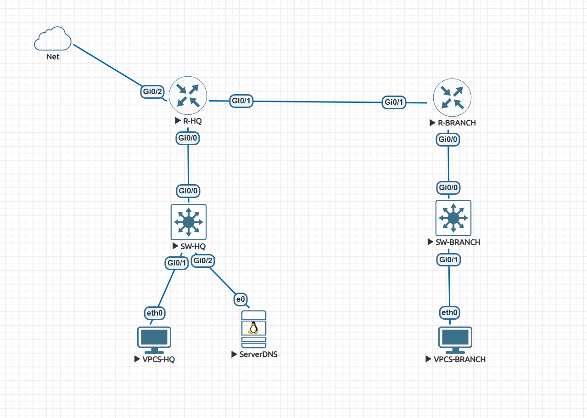

# Сетевая часть лаборатории

Минимальная сетевая схема EVE-NG для лаборатории DNS, VPN и безопасности.

## Устройства

- `R-HQ` — маршрутизатор главного офиса;
- `R-BRANCH` — маршрутизатор филиала;
- `SW-HQ` — коммутатор главного офиса;
- `VPCS-HQ` — клиент HQ;
- `VPCS-BRANCH` — клиент филиала;
- `ServerDNS` — Ubuntu Server с BIND9.

## Сети

| Сеть | Назначение |
|---|---|
| `10.10.10.0/24` | пользователи HQ, VLAN 10 |
| `10.10.20.0/24` | серверная сеть, VLAN 20 |
| `10.20.10.0/24` | пользователи филиала |
| `10.254.10.0/30` | транзит R-HQ ↔ ASA-HQ |
| `10.254.20.0/30` | транзит R-BRANCH ↔ ASA-BRANCH |
| `192.168.96.0/24` | внешняя сеть VMware NAT |

## Основные адреса

- `R-HQ VLAN 10`: `10.10.10.1/24`;
- `R-HQ VLAN 20`: `10.10.20.1/24`;
- `ServerDNS`: `10.10.20.10/24`;
- `R-BRANCH LAN`: `10.20.10.1/24`;
- `VPCS-HQ`: `10.10.10.10/24`;
- `VPCS-BRANCH`: `10.20.10.10/24`;
- `R-HQ ↔ ASA-HQ`: `10.254.10.1/30` и `10.254.10.2/30`;
- `R-BRANCH ↔ ASA-BRANCH`: `10.254.20.1/30` и `10.254.20.2/30`.

## Проверено

- межвлановая маршрутизация;
- маршрутизация HQ ↔ Branch;
- доступ клиентов к DNS-серверу;
- выход HQ и Branch в интернет через NAT;
- отсутствие NAT для внутреннего DNS-трафика.

Полная конфигурация устройств находится в [configs.txt](configs.txt).

## Подтверждающие скриншоты

- `01-r-hq-show-ip-interface-brief.png` — интерфейсы и адреса R-HQ;
- `02-r-branch-show-ip-interface-brief.png` — интерфейсы и адреса R-BRANCH;
- `03-sw-hq-show-vlan-brief.png` — VLAN 10 и VLAN 20 на SW-HQ;
- `04-sw-hq-show-interfaces-trunk.png` — trunk 802.1Q и разрешённые VLAN;
- `05-r-hq-show-ip-route.png` — маршруты R-HQ и маршрут по умолчанию.

Общая схема сети:

